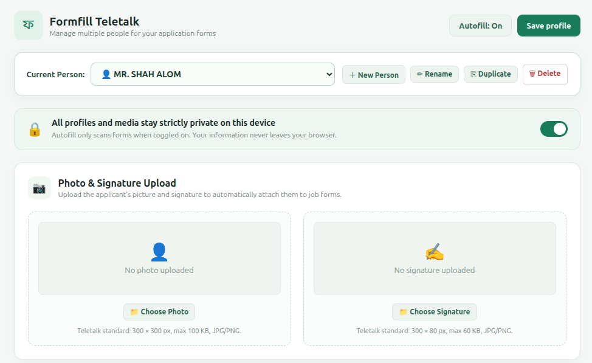
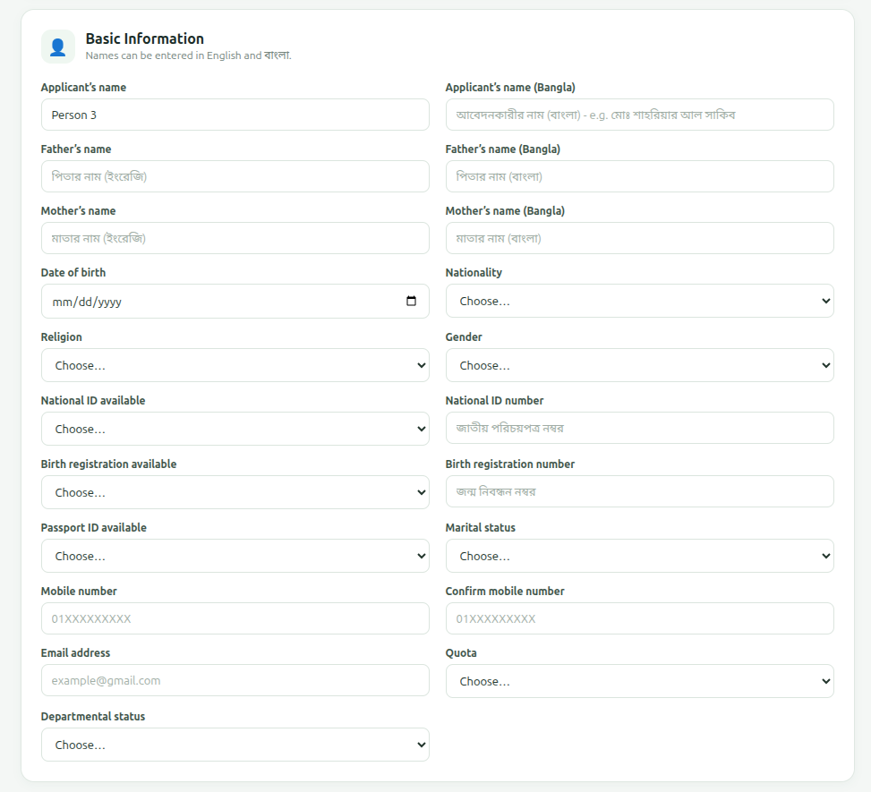
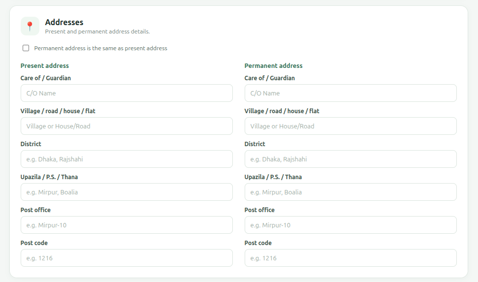
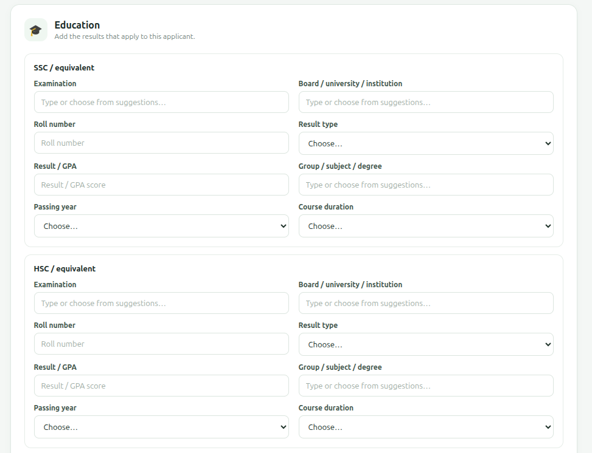
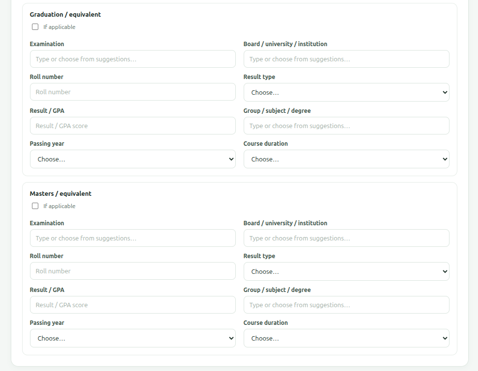
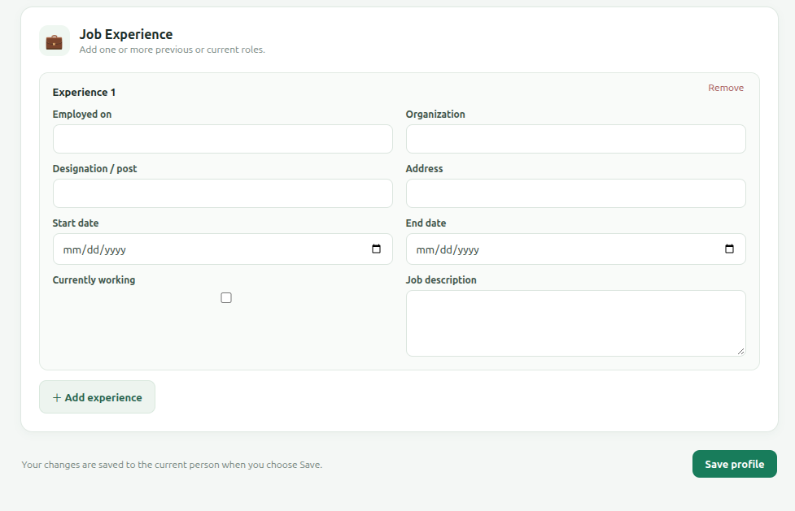
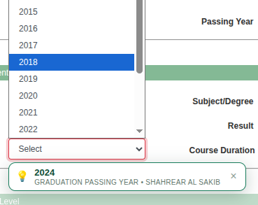

# Formfill Teletalk

<p align="center">
  <strong>Next-Generation Multi-Profile Application Form Assistant for Teletalk & Bangladesh Recruitment Portals</strong>
</p>

<p align="center">
  
</p>

---

## 📖 Overview

**Formfill Teletalk** is a powerful Chrome Manifest V3 extension designed to automate and simplify the tedious process of applying for government, autonomous, bank, and corporate positions in Bangladesh. It specializes in Teletalk-powered recruitment portals (`*.teletalk.com.bd`, `alljobs.teletalk.com.bd`, Petrobangla, BPSC, Ministries, Directorates, and related services).

Filling out repetitive application forms for multiple candidates or jobs often leads to typos, mismatched photo/signature dimensions, and AJAX dropdown timing failures. **Formfill Teletalk** solves all of these challenges by providing:
- **Multiple candidate profiles** with one-click switching.
- **Automated photo and signature uploading** with built-in instant Canvas resizing to strict Teletalk dimensions.
- **In-field auto-suggestions** that offer instant one-click values as you focus any form field.
- **Intelligent dependent dropdown handling** (District → Upazila → Post Office) that waits for dynamic AJAX server responses.
- **Auto-unblocking of optional sections** like Graduation, Masters, and Job Experience (`If Applicable`).
- **Free-text entry with smart matching** for any university, institution, subject, or degree.

---

## 🌟 Key Features

### 1. 👥 Multi-Person Profile Management
* Save and manage multiple applicant profiles (e.g. self, family members, clients, or friends).
* Create new candidates with `＋ New Person`, rename existing profiles, clone details with `⎘ Duplicate`, or remove obsolete entries.
* Quickly select the active applicant from the extension popup or directly on the web page.

### 2. 📷 Photo & Signature Upload with 1-Click Teletalk Sizing
* Store candidate photos and signatures locally as secure base64 data URLs.
* When filling application forms, the extension programmatically creates standard `File` objects and populates `<input type="file">` fields via the `DataTransfer` API.
* **Built-in Instant Image Resizing (HTML5 Canvas):**
  - **Photo:** Formats to **300 × 300 px** (JPEG, max 100 KB).
  - **Signature:** Formats to **300 × 80 px** (JPEG, max 60 KB).

### 3. 💡 In-Field Smart Auto-Suggestion
* Whenever you click or focus any input, select, or file field on an application form, an unobtrusive floating chip appears under the field.
* Displays the candidate's exact value (e.g., `💡 MD. SHAHRIAR AL SAKIB` or `📷 Attach Photo`).
* Click the suggestion to instantly fill that specific field and fire all native change events.

### 4. 🎓 Flexible University & Degree Matching (Free-Text + Suggestions)
* In the profile editor, fields like **Board / University / Institution** and **Group / Subject / Degree** are editable inputs equipped with `<datalist>` suggestions.
* You can pick from common options or freely type any custom university, college, or major.
* When filling out forms, the extension's `findBestOption` algorithm uses token overlap, acronym recognition (e.g. `RU` ↔ `University of Rajshahi`, `BUET`, `DU`, `CSE` ↔ `Computer Science & Engineering`, `EEE`, `BBA`), and fallback matching (`Other` / `Others`).

### 5. 🔓 Automatic Section Unblocking (`If Applicable` Checkboxes)
* Sections such as **Graduation**, **Masters**, and **Job Experiences** on Teletalk forms are locked with HTML `disabled` attributes until the user ticks `If Applicable`.
* The extension automatically detects if the candidate has graduation, masters, or experience details saved, triggers the `If Applicable` checkbox, and unblocks the inputs without manual intervention.

### 6. 📍 Cascading Address Handling (District → Upazila → Post Office)
* Teletalk forms load Upazilas/Thanas dynamically through AJAX after the District changes.
* The extension utilizes a `MutationObserver` and polling sequence to wait for the server's Upazila options to populate before selecting the candidate's Upazila and Post Office.
* Features canonical district matching for alternate spellings (e.g., `Chittagong` ↔ `Chattogram`, `Comilla` ↔ `Cumilla`, `Bogra` ↔ `Bogura`, `Barisal` ↔ `Barishal`, `Jessore` ↔ `Jashore`).

### 7. 🔒 Private & 100% Local
* All data, images, signatures, and candidate details remain strictly on your local computer in Chrome's extension storage.
* No data is ever transmitted to external servers.

---

## 📸 Screenshots & Visual Walkthrough

### 1. Multi-Person Profile Manager & Photo/Signature Setup
Manage multiple people, switch between candidate profiles, toggle scanning permissions, and upload/format photos and signatures according to Teletalk specifications.



---

### 2. Basic Information (English & বাংলা)
Enter comprehensive candidate details including English names, Bengali names, parents' names, national identifiers (NID, Birth Registration, Passport), contact numbers, quota selections, and departmental status.



---

### 3. Present & Permanent Addresses
Configurable address blocks with one-click cloning if the permanent address matches the present address. Includes 64-district autocomplete.



---

### 4. Secondary & Higher Secondary Education (SSC & HSC)
Store examination titles, education boards, roll numbers, passing years, GPA/division results, and groups.



---

### 5. Graduation & Masters Degree Levels
Freely type custom universities or degrees, or pick from autocomplete suggestions. Supports custom course durations and CGPA grading scales.



---

### 6. Multi-Role Job Experience
Add multiple employment histories with organization names, designations, addresses, date ranges, and job descriptions.



---

### 7. In-Field Auto-Suggestion
Focus any input field on the form to see an instant floating suggestion chip for quick single-field filling.



---

## 🚀 Installation Guide

1. Open Google Chrome (or any Chromium-based browser like Brave, Edge, Opera).
2. Navigate to `chrome://extensions`.
3. In the top-right corner, toggle on **Developer mode**.
4. Click the **Load unpacked** button in the top-left corner.
5. In the file picker, select this directory:
   ```text
   /home/noob_coder/Desktop/Auto Formfill Up
   ```
6. The extension is now installed and ready to use!

---

## 🛠️ Usage Instructions

1. **Configure Profiles:**
   - Click the extension icon in your Chrome toolbar and select **Edit person details** (or right-click the icon and choose **Options**).
   - Enter your personal details, present/permanent address, and educational qualifications.
   - Upload your Photo and Signature. Click **Resize to 300×300** and **Resize to 300×80** to format them to exact standards.
   - Click **Save profile**.
   - Use **＋ New Person** to add profiles for other applicants.

2. **Enable Autofill:**
   - Toggle **Autofill** to **On** in the popup or options page (allow the permissions prompt when requested).

3. **Fill an Application Form:**
   - Open any Teletalk job application page (e.g. Petrobangla, BPSC, Ministry job circulars).
   - The **Formfill Teletalk** assistant will appear in the bottom-right corner showing the number of matched fields.
   - Select the individual person you want to fill for from the dropdown.
   - Click **Review & fill**, verify the fields, and click **Fill selected fields**.
   - Alternatively, click directly into any field on the form to use **In-Field Auto-Suggestion**!

---

## 📂 Project Structure

All files created and required by the extension reside strictly within this directory:

```text
Auto Formfill Up/
├── manifest.json              # Chrome Manifest V3 configuration
├── background.js             # Service worker handling storage, tabs, & lifecycle
├── content.js                # Form scanning, matching engine, & floating UI
├── popup.html                # Quick action popup interface
├── popup.js                  # Popup logic and candidate selector
├── options.html              # Full-page candidate profile editor
├── options.js                # Profile manager, media resizer, & form builder
├── ui.css                    # Shared responsive styles
├── icon16.png                # Extension icons (16px, 32px, 48px, 128px)
├── icon32.png
├── icon48.png
├── icon128.png
├── icon.svg                  # Vector source icon
├── screenshots/              # Screenshots referenced in documentation
│   ├── profile_manager.png
│   ├── basic_information.png
│   ├── addresses.png
│   ├── education_ssc_hsc.png
│   ├── graduation_masters.png
│   ├── job_experience.png
│   ├── live_form_filling.jpg
│   └── in_field_suggestion.png
├── Auto Formfill Up.crx      # Packaged extension file
├── Auto Formfill Up.pem      # Packaged extension private key
└── README.md                 # Complete documentation
```

---

## 📜 License

Created for private personal and professional recruitment form filling. All rights reserved.
